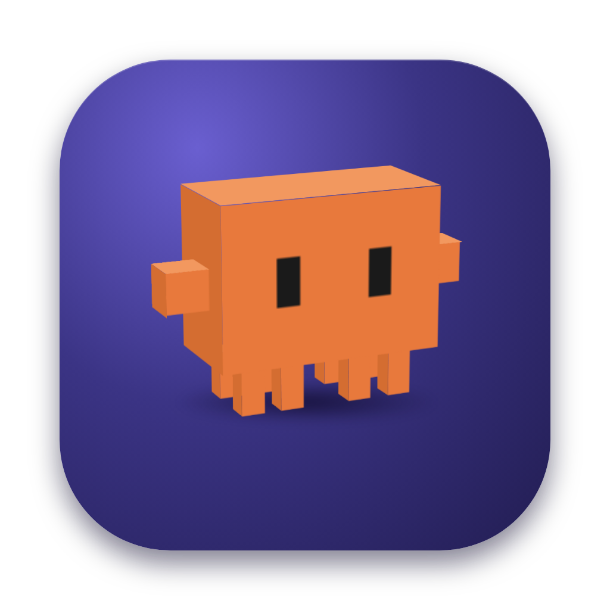
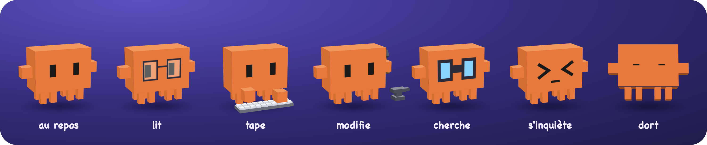

<p align="center"></p>

<h1 align="center">pet-claude</h1>

<p align="center">Un petit compagnon 3D qui vit sur ton bureau macOS et réagit à ce que fait <b>Claude Code</b> :<br>
il lit avec des lunettes, tape sur son clavier, martèle quand Claude modifie un fichier,<br>
s'inquiète quand une commande échoue, et te répond dans une bulle.</p>

<p align="center"></p>

> **Beta** : testé sur macOS (Apple Silicon) avec Claude Code. Voir « Limites connues ».
> Téléchargement : [page des releases](https://github.com/Lonejyc/pet-claude/releases).

## Ce qu'il fait
- **Réagit en direct** à toutes tes sessions Claude Code (quel que soit le dossier) via leurs hooks.
- **Reconnaît tes sessions** : une pastille (nom du projet + couleur) étiquette chaque bulle quand plusieurs sessions sont ouvertes.
- **Mini-chat** : double-clic sur le pet, tape une question. Elle part dans une *copie* de la session choisie
  (`claude -p --resume --fork-session`, lecture seule) : ta session du terminal n'est pas modifiée. `Tab` change de session.
- **Vit** : il cligne des yeux, s'endort, se laisse prendre (il panique), se lance et rebondit sur les bords de l'écran.
- Visible **au-dessus des apps en plein écran**, sur tous les espaces, multi-écrans.

## Direction artistique

Le pet est un **bloc orange pixelisé en volume**, inspiré de petites figurines imprimées en 3D : un corps parallélépipédique,
deux bras carrés, huit pieds courts, des yeux rectangulaires. Il doit être attachant avant d'être utile, et lisible à 150 px.

**Formes et couleurs**
- 11 pavés CSS 3D (corps 95 × 67,5 × 45, pieds courts), arêtes nettes, aucune texture : le relief vient uniquement des faces.
- Orange `#e8793c` en face avant, plus clair sur le dessus (`#f2985f`), plus sombre sur les côtés (`#c9622a`, `#d46d31`) et au dos ; yeux `#1a1a1a`.
- Vue de trois quarts légèrement de dessus au repos : le volume se lit même immobile. Il se tourne vers le curseur et le suit des yeux.
- Icône : le vrai pet 3D sur un carré arrondi violet (`#6a5fd0` → `#221d52`), pour faire ressortir l'orange.
- Barre de menus : silhouette **2D noir et blanc**, de face, yeux découpés (image « template » macOS : le système la teinte en blanc en mode sombre).

**Expression : peu d'éléments, très lisibles**
- Yeux rectangulaires au repos, qui clignent. Yeux plissés `>  <` réservés à l'inquiétude et à la panique, jamais à la réflexion.
- Une bouche rectangulaire apparaît quand il parle (elle s'ouvre et se ferme), plate quand il s'inquiète, grande ouverte quand on le prend.
- Le pet **reflète le travail réel** : un accessoire par famille d'outils (lunettes, clavier, marteau et enclume, jumelles) plutôt qu'un état générique « occupé ».

**Mouvement : écraser, étirer, laisser respirer**
- Squash & stretch : il s'écrase quand on appuie (1,1 × 0,8), rebondit au lâcher, et s'écrase proportionnellement à la force d'un impact.
- Rythmes espacés plutôt que continus : gigotement de réflexion = un aller-retour puis 1,6 s de pause ; marteau = 3 coups puis 1 s de pause ; respiration du sommeil sur 3 s.
- Panique en main : tremblement de ±5°, décollé du sol, pieds qui se balancent ; puis chute, et lancer avec une vraie physique (gravité, rebonds amortis, frottement).
- Rare et juste : le pet ne reparle pas avant un délai réglable (12 s), et les confettis ne tombent qu'après un tour chargé sans échec.

**Voix et sons**
- Bulle de BD : fond blanc, contour de 3 px `#222`, ombre portée dure (3 px, sans flou), coins arrondis, queue vers le pet ; typographie manuscrite système (*Chalkboard SE*, *Comic Sans MS* en secours). Le texte s'écrit lettre par lettre.
- Ton : malicieux, taquin mais bienveillant, tutoiement, une seule phrase de 60 caractères maximum, jamais au détriment de la réponse technique.
- Sons 100 % synthétisés (WebAudio, aucun fichier) : « blips » carrés 8 bits pour la voix, sinus pour le squeeze et le rebond, triangle pour l'inquiétude et le ta-da.
- Plusieurs sessions : chaque projet reçoit une teinte distincte (angle d'or) sur une pastille posée au bord de la bulle.

**Réglages** : une fenêtre sobre aux tons chauds (fond crème, ou brun foncé en mode sombre), cartes blanches, interrupteurs arrondis et l'orange du pet comme unique accent.

## Installer
1. Télécharge `pet-claude-<version>.pkg` depuis la [page des releases](https://github.com/Lonejyc/pet-claude/releases).
2. Il n'est pas signé par un compte développeur Apple : **clic droit sur le fichier, Ouvrir** (sinon macOS refuse).
3. Suis l'installateur : choisis ce qui est configuré (hooks Claude Code, lancement au démarrage, personnalité « Pet »).
4. Relance tes sessions Claude Code déjà ouvertes pour que le pet les voie.

Prérequis : macOS sur Apple Silicon, [Claude Code](https://claude.com/claude-code) installé.

## Utiliser
| Geste | Effet |
|---|---|
| Clic | il s'écrase comme une balle |
| Glisser / lâcher en mouvement | le déplacer / le lancer |
| Double-clic | poser une question (Entrée envoie, Échap ferme, Tab change de session) |
| Icône du pet dans la barre de menus | **Masquer le pet**, **Réglages…** et **Quitter** |
| `/settings` ou `/quit` dans le champ | idem, au clavier (l'icône Dock n'apparaît que pendant les réglages) |

## Ce qui est modifié sur ta machine
- `/Applications/pet-claude.app`
- `~/.claude/settings.json` : cinq hooks (`curl` vers `localhost:4242`) **ajoutés à côté des tiens**, sauvegarde dans
  `settings.json.bak-pet-claude`. Si tu coches la personnalité : `outputStyle: "Pet"` et `~/.claude/output-styles/pet.md`.
- `~/Library/LaunchAgents/io.github.lonejyc.pet-claude.plist` (lancement au démarrage, optionnel)
- `~/Library/Application Support/io.github.lonejyc.pet-claude/` : tes réglages (`settings.json`) et le secret du pet (`token`, lisible par toi seul)

Aucune donnée ne quitte ta machine. Chaque question du mini-chat est un appel normal à Claude (donc comptée comme tel).

## Sécurité et vie privée
- Le pet n'écoute que sur `127.0.0.1:4242` (jamais sur le réseau).
- Il **n'accepte que les requêtes qui portent son secret** (en-tête `X-Pet-Token`, généré au premier lancement, stocké en lecture
  seule pour toi). Il vérifie aussi l'en-tête `Host` (contre le rebinding DNS) et refuse les corps de plus de 4 Mo.
  Résultat : une page web ouverte dans ton navigateur ne peut pas faire parler le pet.
- Ce secret n'empêche pas un programme qui tourne déjà sous ton compte de lire `~/.claude/settings.json` et de le copier : c'est
  le même niveau de confiance que tes autres réglages.
- Le mini-chat ne dispose que de `Read`, `Grep` et `Glob` : il peut lire ton code, mais ne modifie rien et ne lance aucune commande.
- Les modifications de `~/.claude/settings.json` sont atomiques (fichier temporaire puis renommage), conservent les permissions,
  sont précédées d'une sauvegarde, et sont **refusées sans rien écrire** si ce fichier n'est pas du JSON valide.
- Mise à jour depuis les betas 1 et 2 : l'app migre toute seule l'ancien identifiant (`fr.perso.petclaude`) et met à jour
  les hooks pour qu'ils portent le secret.

## Désinstaller
`./scripts/uninstall.sh` retire les hooks, la personnalité, le lancement au démarrage et l'app.

## Limites connues (beta)
- Apple Silicon uniquement, app non signée / non notarisée.
- L'installateur n'a pas pu être exécuté en conditions réelles avant publication (scripts de post-installation en root) :
  en cas de souci, voir `/tmp/pet-claude-install.log`.
- Le mini-chat retrouve `claude` via ton shell de connexion ; non vérifié depuis tous les types d'installation de Claude Code.
- Un seul pet à la fois : si deux instances tournent (par ex. version de développement + installée), seule la première reçoit les hooks.
- Les accessoires du pet (clavier, marteau, enclume, jumelles) sont positionnés « à l'œil » et peuvent légèrement traverser le corps.

## Licence et mentions légales
- Code publié sous **licence MIT** (voir [`LICENSE`](LICENSE)). Les licences des dépendances sont listées dans
  [`THIRD_PARTY_LICENSES.md`](THIRD_PARTY_LICENSES.md) (aucune licence copyleft forte ; 5 crates sous MPL-2.0, utilisées sans modification).
- **pet-claude est un projet indépendant, non affilié à Anthropic, ni approuvé ou sponsorisé par elle.** « Claude » et
  « Claude Code » sont des marques d'Anthropic ; elles ne servent ici qu'à désigner le logiciel avec lequel le pet fonctionne.
- Le logiciel est fourni « tel quel », sans garantie (voir la licence). Il modifie `~/.claude/settings.json` : une sauvegarde est faite, mais
  lis la section « Ce qui est modifié sur ta machine » avant d'installer.

## Développer
```sh
cd app && npm install && npm run tauri dev      # pet en développement (Rust requis)
cd app && npm run build && cd src-tauri && cargo test   # tests (la CI lance la même chose)
./scripts/demo.sh                               # rejoue toutes les animations sans Claude
./scripts/make-icon.sh                          # régénère l'icône depuis le pet 3D (serveur de dev lancé)
./scripts/make-readme-images.sh                 # régénère les images du README depuis le pet 3D
./installer/build-pkg.sh                        # construit l'installateur .pkg
```
Stack : Tauri 2, TypeScript, CSS 3D, `tauri-nspanel`. Fenêtre en `NSPanel` non activant ; positions et souris en
coordonnées natives macOS (les conversions de Tauri se mélangent entre écrans d'échelles différentes).
